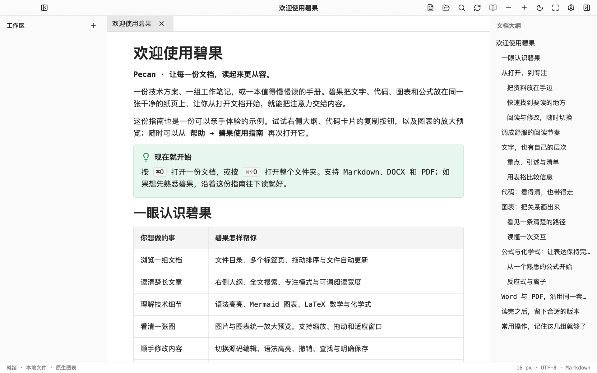

<div align="center">
  
  <h1>Pecan · 碧果</h1>
  <p><strong>让技术文档，回归阅读。</strong></p>
  <p>macOS、Windows 与 Linux 上的原生 Markdown 阅读器，也能顺手编辑，<br />并在本地把 Word、PDF 等文档重排成适合阅读的样子。</p>
  <p>
    <a href="https://github.com/madebynut/pecan/releases"></a>
    <a href="https://github.com/madebynut/pecan/actions/workflows/check.yml"></a>
    <a href="LICENSE"></a>
    
  </p>
  <p>
    <a href="https://github.com/madebynut/pecan/releases"><b>下载</b></a> ·
    <a href="samples/welcome.md">功能示例</a> ·
    <a href="#从源码构建">从源码构建</a> ·
    <a href="https://github.com/madebynut/pecan/issues">反馈问题</a>
  </p>
</div>

<picture>
  <source media="(prefers-color-scheme: dark)" srcset="assets/screenshots/reader-dark.png" />
  
</picture>

## 为什么是碧果

技术文档里有代码、表格、流程图和公式，而大多数阅读器只照顾好了文字。碧果用 Rust 与 GPUI 直接绘制每一个元素，把它们放在同一张干净的纸页上：

- **原生、安静。** 不嵌浏览器内核，长文档按需渲染，滚动和缩放都跟手。
- **原文件不变。** 阅读、格式化和预览都不写盘，只有你按下保存才写入；外部程序改过文件时，保存前会先检查冲突。
- **全部在本地完成。** Mermaid、LaTeX、Word 与 PDF 的转换都在本机进行，不上传任何内容。
- **一套排版，处处一致。** 正文里的样式会一路带到 PDF、Word 和 HTML 导出。

## 功能一览

| 阅读与导航 | 内容与表达 | 分享与输出 |
| :--- | :--- | :--- |
| 阅读与源码一键切换 | Markdown 编辑、高亮、撤销与查找 | 保存、另存为，外部修改冲突检查 |
| 多标签、拖动排序、最近文件 | 表格、任务列表、GitHub 风格提示块 | 导出 PDF、Word、HTML、Markdown |
| 工作区目录、标题大纲、全文查找 | Mermaid 原生渲染与高清放大 | Mermaid 图表单独导出 SVG / PNG |
| 浅色、深色或跟随系统 | LaTeX 数学公式与 mhchem 化学式 | PDF 保留可选中文字与矢量图表 |
| 中英文字体、字号、行高分别设置 | 代码高亮、折叠、缩进线、一键复制 | Word 保留可编辑的段落与表格 |

图片和图表点击即可放大，支持缩放、拖动和适应窗口。网络图片加载时显示占位骨架；加载慢或失败时，点右上角的重新加载按钮即可重试。

### 文档格式

| 方向 | 格式 |
| :--- | :--- |
| 阅读与编辑 | Markdown（`.md` `.markdown` `.mdown`），UTF-8，保留原有的 BOM 与换行符 |
| 导入阅读 | Word（`.docx` `.docm` `.doc`）、PDF、RTF、OpenDocument（`.odt` `.ods` `.odp`）、EPUB、演示文稿（`.pptx` `.ppt`）、表格（`.xlsx` `.xls` `.csv`） |
| 导出 | PDF、Word（`.docx`）、单文件 HTML（图片、图表与公式内嵌）、带图片目录的 Markdown |

导入的文档重排后阅读，修改会另存为 Markdown。复杂分页和批注可能无法完整重排；PDF 只提取文字，不做 OCR，扫描版 PDF 可以用「原版查看」阅读。Mermaid 与 LaTeX 覆盖常见的图表与数学、化学表达式，不覆盖 Mermaid.js 的全部扩展或任意 TeX 宏包。

### 常用快捷键

macOS 使用 `⌘`，Windows 与 Linux 使用 `Ctrl`。

| 操作 | macOS | Windows / Linux |
| :--- | :--- | :--- |
| 打开文件 / 打开文件夹 | `⌘O` / `⌘⇧O` | `Ctrl+O` / `Ctrl+Shift+O` |
| 阅读与源码切换 | `⌘E` | `Ctrl+E` |
| 保存 / 另存为 | `⌘S` / `⌘⇧S` | `Ctrl+S` / `Ctrl+Shift+S` |
| 查找 | `⌘F` | `Ctrl+F` |
| 文件栏 / 大纲 | `⌘B` / `⌘L` | `Ctrl+B` / `Ctrl+L` |
| 专注阅读 | `⌘⇧F` | `Ctrl+Shift+F` |
| 放大 / 缩小 / 还原字号 | `⌘+` / `⌘-` / `⌘0` | `Ctrl++` / `Ctrl+-` / `Ctrl+0` |
| 重新加载 | `⌘R` | `Ctrl+R` |
| 切换标签 | `⌃Tab` / `⌃⇧Tab` | `Ctrl+Tab` / `Ctrl+Shift+Tab` |
| 关闭标签 / 设置 | `⌘W` / `⌘,` | `Ctrl+W` / `Ctrl+,` |
| 全屏 | `⌃⌘F` | `F11` |

正文右键也能「查看源码」。有未保存的修改时，关闭标签、关闭窗口、退出或切回阅读都会询问保存、不保存或取消；选择不保存时，阅读页仍显示当前草稿，不写入文件。

## 下载与安装

在 [Releases](https://github.com/madebynut/pecan/releases) 下载对应平台的压缩包，`SHA256SUMS.txt` 可用来校验下载文件。

<table>
  <tr><th align="left">平台</th><th align="left">安装方式</th></tr>
  <tr>
    <td><b>macOS</b><br />12 及以上<br />Apple 芯片 / Intel</td>
    <td>解压后把 <code>Pecan.app</code> 拖进「应用程序」。发布包未经公证，第一次打开请在 Finder 中右键选「打开」。之后可以在访达里用「打开方式 → Pecan」打开文档，或把文件、文件夹拖到程序坞图标上。</td>
  </tr>
  <tr>
    <td><b>Windows</b><br />10 1803 及以上<br />x64</td>
    <td>解压后直接运行 <code>Pecan.exe</code>，不需要另装运行库。也可以用 <code>Setup.exe</code> 安装：不需要管理员权限，会添加开始菜单入口和卸载项，并把支持的文档加入「打开方式」，不会替换已有的默认程序。程序未签名，SmartScreen 提示时选「更多信息 → 仍要运行」。</td>
  </tr>
  <tr>
    <td><b>Linux</b><br />glibc 2.39 及以上<br />x64</td>
    <td>解压后运行 <code>./install.sh</code>，程序、图标和桌面项装到当前用户的 <code>~/.local</code>；<code>./uninstall.sh</code> 卸载，加 <code>--purge</code> 同时删除设置与日志。设为默认的 Markdown 阅读器：<code>xdg-mime default com.pecan.reader.desktop text/markdown</code>。</td>
  </tr>
</table>

<details>
<summary><b>Linux：发行版与运行时依赖</b></summary>

<br />

发布包在 Ubuntu 24.04 上构建，需要 glibc 2.39 或更新版本；在更旧的系统上启动会报 `version 'GLIBC_2.39' not found`。运行 `ldd --version` 可以查看当前版本。

| 可以运行 | 不能运行 |
| :--- | :--- |
| Ubuntu 24.04 LTS 及以上、Debian 13、Fedora 40 及以上、RHEL / Rocky / Alma 10、Arch Linux、openSUSE Tumbleweed | Ubuntu 22.04 LTS（glibc 2.35）、Debian 12（2.36）、RHEL / Rocky / Alma 9（2.34） |

| 用途 | Debian / Ubuntu | Fedora / RHEL |
| :--- | :--- | :--- |
| 键盘与 X11（启动必需） | `libxcb1` `libxkbcommon0` `libxkbcommon-x11-0` | `libxcb` `libxkbcommon` `libxkbcommon-x11` |
| Wayland 会话 | `libwayland-client0` `libwayland-egl1` | `libwayland-client` `libwayland-egl` |
| 图形渲染（优先 Vulkan，没有时退回 OpenGL ES） | `libvulkan1` `mesa-vulkan-drivers` `libegl1` | `vulkan-loader` `mesa-vulkan-drivers` `mesa-libEGL` |
| 打开与保存对话框 | `xdg-desktop-portal` 及与桌面匹配的后端（`-gtk`、`-gnome` 或 `-kde`） | 同左 |
| 中文字体 | `fonts-noto-cjk` | `google-noto-sans-cjk-fonts` |

没有安装中文字体时，中文会显示为方框。

</details>

<details>
<summary><b>Windows：显卡与运行库</b></summary>

<br />

需要支持 Direct3D 11 的显卡；没有显卡（例如部分虚拟机）时会使用系统自带的软件渲染。发布包静态链接 C 运行库，不依赖 Visual C++ 运行库。

</details>

## 你的数据

碧果只在两种情况下联网，其余操作都在本机完成：

- **文档里的网络图片。** 按文档中的地址下载，单张最多 16 MiB。重定向不会从 HTTPS 降级，也不会从公网地址跳到本机或内网地址。
- **启动时检查新版本。** 启动 5 秒后向 GitHub Releases 发一次匿名请求，只带 GitHub 要求的 `User-Agent: Pecan/<版本>`。有新版本时，状态栏右下角显示「新版本 X 可用」，点击用浏览器打开该版本的发布页，点 × 隐藏到下次启动；「关于」窗口里也有「查看新版本」按钮。不会自动下载或安装。正式版只提示更新的正式版，预发布版还会提示更新的预发布版。可在「设置 → 通用 → 检查新版本」关闭。

碧果在本机保存的文件：

| 内容 | macOS | Windows | Linux |
| :--- | :--- | :--- | :--- |
| 设置与最近文件 | `~/Library/Application Support/Pecan` | `%APPDATA%\Pecan` | `~/.config/Pecan` |
| 未保存草稿的恢复副本 | `~/Library/Application Support/Pecan/Recovery` | `%LOCALAPPDATA%\Pecan\Recovery` | `~/.local/state/Pecan/recovery` |
| 运行日志与崩溃报告 | `~/Library/Logs/Pecan` | `%LOCALAPPDATA%\Pecan\logs` | `~/.local/state/Pecan/logs` |

Linux 上设置了 `XDG_CONFIG_HOME` 或 `XDG_STATE_HOME` 时，以环境变量为准。

**草稿恢复。** 源码有未保存的修改时，碧果每 2 秒把草稿另存一份到恢复目录。如果碧果崩溃，或注销、关机时系统没来得及询问，下次启动会提示恢复。原文件没被其他程序改过时，草稿在原文件上继续编辑；原文件已经变了，保存时会提示冲突，不会直接覆盖。保存或选择「不保存」后，恢复副本随即删除。

**安全边界。** 文档里的链接只会交给系统打开 `http`、`https` 与 `mailto`，`file:`、应用协议和本地路径一律不执行。Windows 上，文档只能读取本机图片或文档所在网络共享里的图片，避免向其他主机发送登录凭据。导入的文档有大小上限，转换超过 2 分钟会停止等待并提示错误。

**排查问题。** 遇到问题时，日志目录里的 `pecan.log` 和 `crash.log` 最有帮助，提交 Issue 时可以一并附上。用 `RUST_LOG=debug` 启动可以看到更详细的日志。

## 从源码构建

| 依赖 | 要求 |
| :--- | :--- |
| Rust | **1.98** 及以上（edition 2024） |
| macOS | Xcode Command Line Tools |
| Windows | Visual Studio 2022 Build Tools 的「使用 C++ 的桌面开发」与 Windows SDK |
| Debian / Ubuntu | `pkg-config` `libxkbcommon-dev` `libxkbcommon-x11-dev` `libwayland-dev` `libvulkan-dev` `libfontconfig1-dev` |
| Fedora / RHEL | `pkgconf` `libxkbcommon-devel` `libxkbcommon-x11-devel` `wayland-devel` `vulkan-loader-devel` `fontconfig-devel` |

```sh
git clone https://github.com/madebynut/pecan.git
cd pecan
cargo run --locked --release --bin Pecan
```

提交改动前，请确认格式、静态检查和测试都通过，和 CI 保持一致：

```sh
cargo fmt --all -- --check
cargo clippy --locked --workspace --all-targets --all-features -- -D warnings
cargo test --locked --workspace --all-features -- --test-threads=1
```

打包脚本在 `scripts/` 下：`bundle-macos.sh`、`bundle-windows.ps1`、`bundle-linux.sh`，需要 Python 3（Linux 还需要 `zip`，Windows 安装程序需要 Inno Setup 6）。自行构建的 Linux 程序要求的 glibc 版本与构建机器相同，要支持更旧的发行版，需在对应的旧系统或容器里构建。

<details>
<summary><b>项目结构</b></summary>

<br />

| 目录 | 内容 |
| :--- | :--- |
| `crates/pecan-app` | 桌面应用：窗口、阅读视图、编辑、导出界面 |
| `crates/pecan-document` | Markdown 解析、分块索引与搜索 |
| `crates/pecan-import` | Word、PDF 等文档的本地导入 |
| `crates/pecan-export` | PDF、Word、HTML、Markdown 导出 |
| `crates/pecan-mermaid` / `pecan-math` | Mermaid 图表与 LaTeX 公式渲染 |
| `crates/pecan-code` / `pecan-format` | 代码高亮与格式化 |
| `crates/pecan-config` / `pecan-edit` / `pecan-network` | 设置与最近文件、原子保存、受限网络客户端 |
| `vendor/` | 带补丁的 GPUI、usvg、Mermaid 渲染器与文档转换库 |
| `samples/` | 功能示例与验收文档 |

</details>

## 参与

欢迎通过 [Issues](https://github.com/madebynut/pecan/issues) 反馈问题或提出建议，请附上系统版本、碧果版本和能复现问题的文档片段。安全问题请不要公开提交，通过仓库的 [Security](https://github.com/madebynut/pecan/security) 页面私下报告。

## 许可

碧果以 [Apache License 2.0](LICENSE) 开源。第三方组件与字体的许可见 [NOTICE](NOTICE) 和 [`licenses/`](licenses) 目录。
