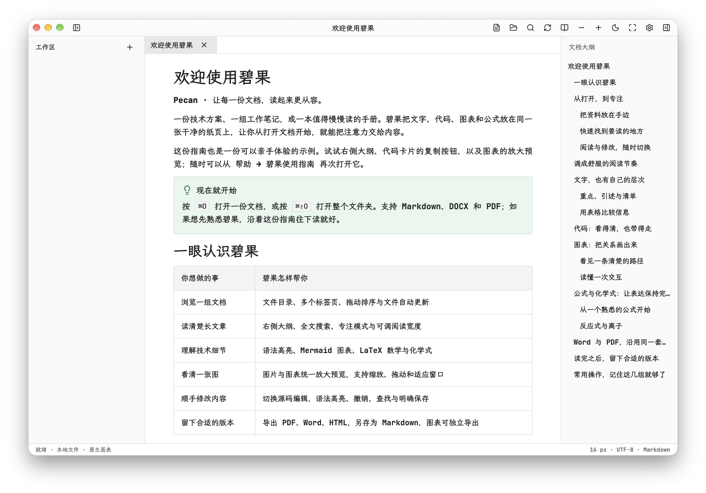

  
  <h1>Pecan · 碧果</h1>
  
<strong>让技术文档，回归阅读。</strong>

  
一款为技术文档而生的原生 Markdown 阅读器。 代码、表格、图表与公式，排在同一张安静的纸页上。

  

    
    
    
  

  

    <a href="https://github.com/madebynut/pecan/releases"><b>下载</b></a> ·
    <a href="samples/welcome.md">功能示例</a> ·
    <a href="https://github.com/madebynut/pecan/issues">反馈问题</a>
  

<picture>
  <source media="(prefers-color-scheme: dark)" srcset="assets/screenshots/reader-dark.png" />
  
</picture>

<table>
  <tr>
    <td width="33%" valign="top"><b>原生绘制</b> 用 Rust 与 GPUI 直接绘制每个元素，不嵌浏览器内核。长文档按需渲染，滚动与缩放始终跟手。</td>
    <td width="33%" valign="top"><b>原文件不变</b> 阅读、格式化与预览都不写盘。只有按下保存才写入，写入前还会确认文件没被其他程序改过。</td>
    <td width="33%" valign="top"><b>一切在本机</b> 图表、公式和 Word、PDF 的转换都在本地完成，文档内容不离开你的电脑。</td>
  </tr>
</table>

## 读得舒服

**排版为长文而调。** 中文与英文字体分别设置，字号、行高和页面宽度各自可调；浅色、深色或跟随系统。

**找得到要读的地方。** 左侧是整个工作区的文件目录，右侧是随正文滚动的标题大纲，全文查找逐个定位结果。多个文档以标签页并排，可以拖动排序，最近打开的文件和文件夹随手可回。

**图片看得清。** 点击任何图片或图表，都会在独立窗口里放大，支持缩放、拖动和适应窗口。网络图片加载时先占好位置，正文不跳动；网速慢或加载失败时，点右上角即可重新加载。

**提示块一眼分明。** GitHub 风格的 `NOTE`、`TIP`、`IMPORTANT`、`WARNING`、`CAUTION` 提示块各有颜色和图标，表格、任务列表与引用都保持清晰的层次。

## 技术内容，原样呈现

**代码。** 常见编程语言与配置格式的语法高亮，配有语言标识、折叠、缩进参考线和一键复制。JSON、YAML、TOML 等配置会按设定的缩进自动排好，源 Markdown 不会被改写。

**Mermaid 图表。** 流程图、时序图等在本机原生绘制，不依赖浏览器。放大后依然锐利，也可以单独导出为 SVG 或 PNG。

**数学与化学式。** LaTeX 行内与独立公式，支持分式、矩阵，以及 `\ce{}` 化学方程式与 `\chemfig{}` 结构式。内置 STIX Two Math 与 Latin Modern Math 两套数学字体，字号独立于正文。

下面两段写法在碧果里同样直接绘制：

<table>
  <tr>
    <td width="50%" valign="top">

</td>
    <td width="50%" valign="top">

$$
\int_{-\infty}^{\infty} e^{-x^2}\,dx = \sqrt{\pi}
$$

$$
\ce{2H2 + O2 -> 2H2O}
$$

</td>
  </tr>
</table>

## 不只是 Markdown

**打开别的格式。** Word、PDF、RTF、OpenDocument、EPUB、演示文稿与表格，都能在本地重排成适合阅读的正文，并沿用同一套排版与大纲。PDF 还可以随时切到原版页面查看。

**带走读完的内容。** 一份文档可以导出为四种形式，排版与正文保持一致：

| 导出为   | 保留下来的                                 |
| :------- | :----------------------------------------- |
| PDF      | 可选中、可搜索的文字，矢量的图表与公式     |
| Word     | 可继续编辑的段落、列表与表格               |
| HTML     | 单个文件，图片、图表与公式全部内嵌         |
| Markdown | 原始源码，引用的图片一并复制到旁边的文件夹 |

## 安心使用

- 文档里的链接只会交给系统打开 `http`、`https` 和 `mailto`，不会因为点了一下就运行本地程序。
- 网络图片按文档中的地址加载，跳转不会从 HTTPS 降级，也不会从公网转向你的本机或内网。
- 启动后会匿名查询一次 GitHub Releases，有新版本时在状态栏轻轻提示，不会自动下载或安装；可以在设置里关闭。

## 许可

碧果以 [Apache License 2.0](LICENSE) 开源。第三方组件与字体的许可见 [NOTICE](NOTICE) 与 [`licenses/`](licenses) 目录。
