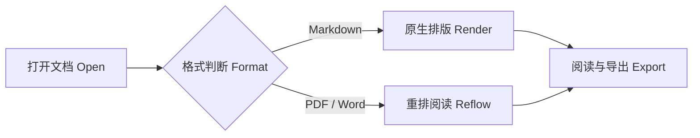
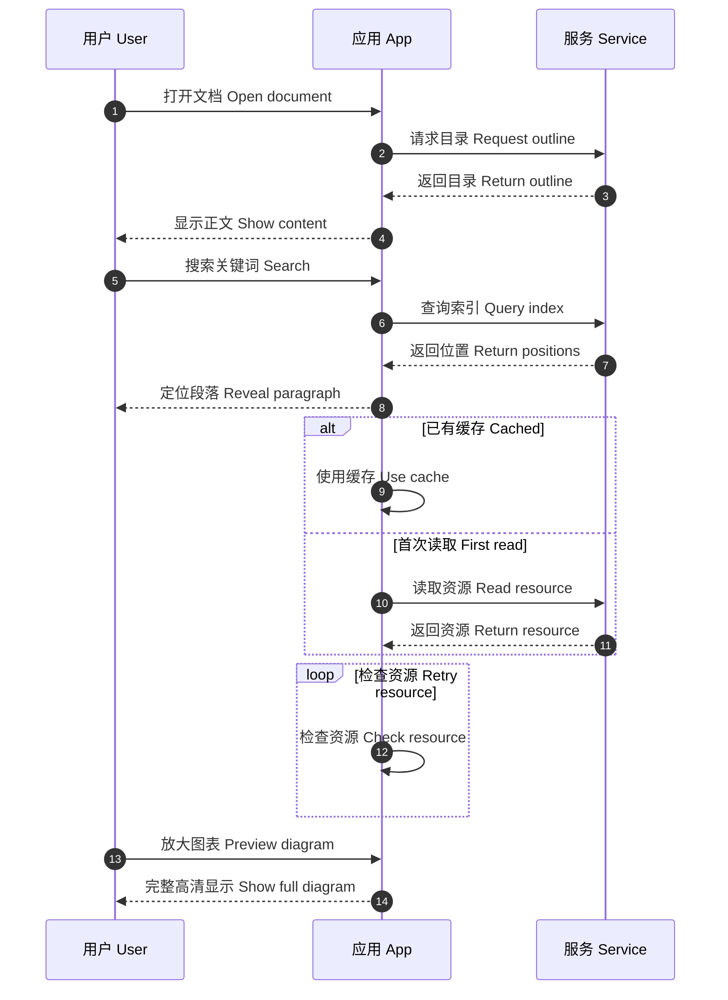

# Pecan 阅读与导出验收 `code`

本页集中呈现近期修复涉及的排版与交互案例。先在碧果中阅读，再从「文件」菜单或正文右键菜单导出为 Word 和 PDF，对照同目录的 `acceptance-guide.md` 逐项检查。图片使用随附本地文件，可离线验收。

## 1 行内代码与段落

中文 `request_id` 中文，English `inline_code` English。短代码 `i`、快捷键 `⌘F`、中文代码 `设备状态` 与较长代码 `GET /api/devices/{device_id}` 都应保持适当留白。

字段 `location_time` 取 SDK 返回的 `rtc_time`。两侧空格来自本页原文，代码内部没有补入用于撑宽胶囊的空格。试着选择并复制代码，检查实际文本。

这是用于检查正文两端对齐与段落行距的长段落。阅读区应保持平稳的文字节奏，中文与 English words、**粗体文字**、*斜体说明*及 `model_setting` 能在同一行中自然排列。缩窄正文宽度后，胶囊仍应完整，最后一行应保持自然宽度。Word 导出采用适合纸面阅读的字号与行距，正文不能因混排被无故撑得很松。

## 2 标题中的 `inline_code`

### 三级标题 `request_id`

这一段用来检查标题与后续内容之间的留白。

#### 四级标题 `device_id`

这一段用来检查较小标题中的胶囊垂直位置。

##### 五级标题 `status`

标题应与正文有清楚的层次。

###### 六级标题 `value`

六级标题仍应容易辨认；点击右侧大纲检查定位位置。

## 3 待办与列表

- [x] 找到要读的资料
- [x] 通过大纲了解文章结构
- [ ] 搜索关键词，比较相关章节
- [ ] 看清图表，把需要的信息留下来；本项特意较长，用于缩窄正文后检查换行与复选框的首行对齐。

1. 普通有序列表。
2. 带有 **强调** 和 `inline_code` 的条目。
   - 嵌套列表保持自己的缩进。
   - 后续条目保持同一文本列。

## 4 引用与提示块

> 引用使用灰色文字，与代码注释保持接近的视觉层次，四周保留合适的内边距。
>
> 第二段包含 **强调**、`request_id` 和 [Rust 官方网站](https://www.rust-lang.org)。
>
> > 嵌套引用仍需有留白，结束后恢复正文的正常宽度。

> [!NOTE] 说明
> 蓝色说明块，包含 `value` 与 **重点内容**。

> [!TIP] 建议
> 绿色建议块，标题与图标应对齐。

> [!IMPORTANT] 重要
> 紫色重要块，标题字号应与其他类型一致。

> [!WARNING] 注意
> 橙色注意块，正文与边框之间保留留白。

> [!CAUTION] 谨慎
> 红色风险块，PDF 和 Word 导出也应保持分类配色。

> [!INFO] 信息
> 信息提示沿用说明类蓝色，标题与其他类型一致。

> [!ERROR] 错误
> 错误提示沿用风险类红色，检查图标与标题的垂直位置。

## 5 无标题高亮块

:::
`location_time` 取 SDK 返回的 `rtc_time` 字段值。正文应紧跟灯泡图标，图标与第一行居中。
:::

:::
**参考文档**

- 地理定位：[Geolocation API](https://developers.google.com/maps/documentation/geolocation/requests-geolocation?hl=zh-cn)
- 反向地理编码：[Geocoding API](https://developers.google.com/maps/documentation/geocoding/requests-reverse-geocoding?hl=zh-cn)

正文与较长链接应自然换行，中文字符之间不能被拉得很开。
:::

:::
**高亮块中的代码卡片**

这里的代码应与普通代码卡片保持同样的操作栏与阅读样式。

```jsonc
{
    "document": "技术方案",
    "reading": {
        "font_size": 16,
        "code_size": 14,
        "tab_size": 4
    },
    "providers": [
        { "type": "gps", "enabled": true },
        { "type": "network", "enabled": false }
    ] // 保留注释，格式化只调整排版
}
```
:::

## 6 表格

| 名称 | 内容 | 多行对照 |
| --- | --- | --- |
| 行内代码 | `request_id` 与 **重要内容** | 第一行<br>第二行<br>第三行 |
| 数学 | $E=mc^2$ | 短内容应在所在行中垂直居中 |
| 长字段 | `GET /api/devices/{device_id}/location/history?from=2026-01-01&to=2026-12-31` | 阅读区保持内容宽度，必要时水平滚动 |
| 链接 | [Rust 文档](https://doc.rust-lang.org/) | 只有明确的换行符才主动分行 |

## 7 代码缩进与工具栏

### 两列空格

```json
{
  "name": "Pecan",
  "reading": {
    "enabled": true,
    "width": 960
  }
}
```

### 真正的 Tab

```jsonc
{
	"tab": {
		"description": "本块含真正的制表符，可切换 2 / 4 / 8 列",
		"enabled": true
	}
}
```

### 语法高亮与水平滚动

```rust
// 注释保持次要颜色；下面的长行应水平滚动。
fn read_document(path: &str) {
    let message = "这是一行较长的代码，用于验证代码不会自动换行、水平滚动可以看全、完整复制不会丢失文字，也用于对照顶部语言标签与操作图标的边距。";
    println!("{path}: {message}");
}
```

长代码与底边框的专项案例见同目录 `long-code.md`。阅读时完整展开，在正文中上下滚动，观察代码卡片下边框。

## 8 数学与化学

行内公式 $E=mc^2$ 与正文共同排版；切换暗色主题后公式文本仍应清晰。

$$
\frac{1}{n}\sum_{i=1}^{n}(x_i-\bar{x})^2
$$

$$
\ce{N2 + 3H2 <=> 2NH3}
$$

## 9 Mermaid

### 流程图



### 时序图与两位步骤序号



正文中的 `</>` 查看源码；复制与导出使用各自图标。放大窗口专注看图，底部提供缩放操作。按 Escape 返回正文后，移动鼠标不应继续选中文本。

## 10 图片


正文图片应跟随阅读宽度等比例显示，点击后进入统一放大预览。关闭预览后再操作正文，检查是否仍有意外的拖选状态。网络图片另见同目录 `network-image.md`。
