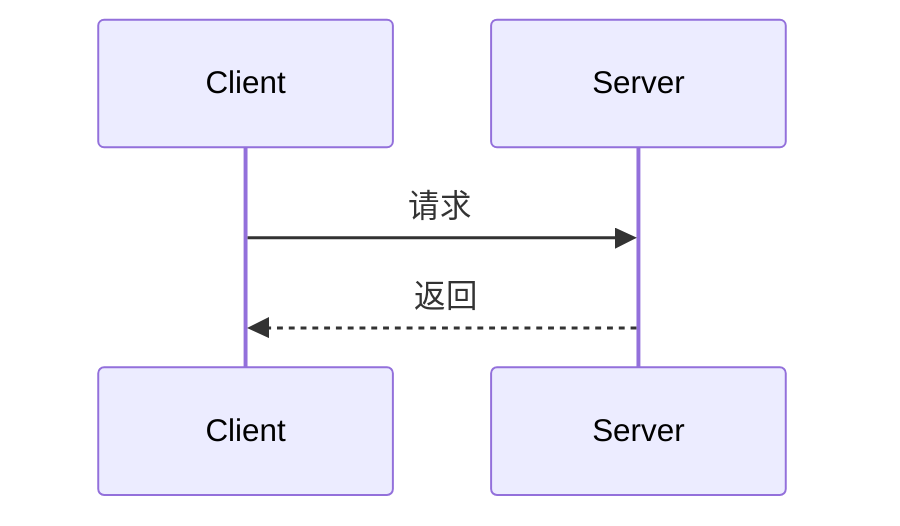

# 多语言自动格式化验收

本页源码有意使用不整齐的排版。先在 **设置 → 阅读 → 代码 → 缩进与 Tab 宽度** 选择 **4 列**，再打开本页；支持的代码块应在后台自动整理，不需要点击格式化按钮。切换为 2 或 8 列后，重新打开或刷新本页，检查全局配置。

- 每块工具栏只保留 **Tab 宽度、折叠、复制**。
- 在一块内连续选择 **2 → 8 → 4 列**，最后应按 4 列排版，其它块保持原配置。
- 搜索「中文设备」，应定位到对应的格式化文字，复制可得到当前完整排版。
- 修改正文、代码字号或主题，滚出后再返回，检查语法高亮、水平滚动和原生边框。
- 原始 Markdown 与 Markdown 导出保留原文；PDF／Word／HTML 按全局 Tab 配置导出格式化代码。未支持、语法无效或超出预算的块保持原文。

## JSON 和配置

JSON 的注释、字段顺序、重复键和数值写法保持。

```jsonc
{"reader":{"name":"中文设备","width":960,"scale":1.2300e+04},"ports":[8080,8081],"same":1,"same":2 // 注释不能丢
}
```

```yaml
# 服务配置
reader:
  name: "中文设备"
  ports: [8080,8081]
  settings:
    active: true
```

```toml
[reader]
name="中文设备"
ports=[
  8080, # 监听端口
  8081,
]
```

## JavaScript 和 TypeScript

```javascript
// 中文设备：保留注释与字面量
function read(name){if(name){const options={name,active:true,ports:[8080,8081]};return options;}return null;}
```

```ts
interface Device{name:string;port:number;}function load(id:string):Device{const device={name:"中文设备",port:8080};return device;}
```

```jsx
const Card=(props)=>{return <section><h2>{props.title}</h2><p>中文设备</p></section>;};
```

```tsx
type Props={title:string;};const Card=(props:Props)=>{return <section><h2>{props.title}</h2><p>中文设备</p></section>;};
```

## 样式

```css
/* 卡片样式 */
.card{color:#333;background:#fff;padding:16px;}.card code{font-size:14px;content:'a  b';}
```

```scss
$ink:#333;.card{color:$ink;.title{font-weight:600;padding:8px;}}
```

```less
@ink:#333;.card{color:@ink;.title{font-weight:600;padding:8px;}}
```

```sass
.card
  color: #333
  .title
    padding: 8px
    font-weight: 600
```

## HTML、XML 与组件

严格保留文字之间的语义空格，预格式化文本和字符串中的连续空格不能丢。

```html
<div><section><p>中文设备 <strong>active</strong></p><pre>a  b
  c</pre></section></div>
<script>function ready(){return {active:true,ports:[8080,8081]};}</script>
```

```xml
<devices><device id="one"><name>中文设备</name><port>8080</port></device></devices>
```

```vue
<template><section><h2>{{ name }}</h2></section></template>
<script setup lang="ts">const name:string='中文设备';function options(){return {port:8080,active:true};}</script>
<style>.title{color:#333;padding:8px;}</style>
```

```svelte
<script>const name='中文设备';function options(){return {port:8080};}</script>
<section><h2>{name}</h2></section>
```

```astro
---
const name='中文设备';const ports=[8080,8081];
---
<section><h2>{name}</h2></section>
```

## SQL 和数据库别名

SQL 进行词元排版，不能替代数据库的语法和语义检查。语言图标仍区分数据库。

```sql
select id,name from devices where active=true and id in (select device_id from sessions) order by name;
```

```mysql
select `id`,`name` from `devices` where `name`='中文设备' and `id` in (1,2,3);
```

```pgsql
select payload->>'name' as name from devices where id=$1 and payload @> '{"active":true}';
```

```tsql
select [id],[name] from [devices] where [id]=@id and [name]=N'中文设备';
```

## 引用、列表和高亮块

这些代码也应在加载时自动处理；两个相同源码的块不能共享折叠状态。

> [!NOTE]
> 提示块内的代码。
>
> ```json
> {"nested":{"title":"中文设备","ports":[8080,8081]}}
> ```

::: info
**高亮块**支持 Markdown 与相同的原生代码工具栏。

```json
{"nested":{"title":"中文设备","ports":[8080,8081]}}
```
:::

- 列表内嵌代码：

  ```yaml
  reader:
    name: "中文设备"
    settings:
      port: 8080
  ```

## Windows 换行与围栏缩进

将本页另存为 CRLF 换行后重新打开，顶层多行代码也应自动格式化。下方围栏本身有两格前导缩进，正文不能因为 CommonMark 去除缩进而错过预处理缓存。

  ```json
  {"indent":{"name":"中文设备","port":8080}}
  ```

## 安全保留

下面语法无效，加载后应保留原文；手动切换 Tab 时明确提示失败。

```json
[1,,]
```

```yaml
reader: [
```

```typescript
const = ;
```

Rust、Python、Shell 等尚未接入专用格式化后端，不调用其它语言的解析器；仍支持语法高亮和实际 Tab 宽度调整。下方原始空格不应改成 4 列。

```rust
fn main(){
  println!("中文设备");
}
```

```python
def main():
  print("中文设备")
```

```unknown
first
  second
```

Mermaid 不属于普通代码格式化器，继续采用图表渲染及独立源码视图。


