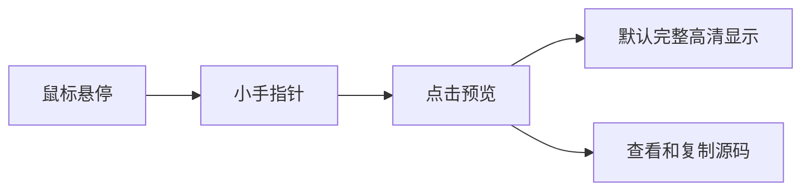

# 图片与图表预览

图片和 Mermaid 上的鼠标指针会变成小手。点击进入统一 GPUI 大图预览，默认完整适配；底部提供缩小、比例、放大、适应窗口和原始尺寸，支持触控板缩放及拖动查看，按 Escape 返回文档。Mermaid 查看与复制源码保留在正文卡片的 `</>` 与复制按钮中。macOS 图片右键菜单可选择「系统快速查看」。

正文宽度默认 960px，可在设置中调整。块级图片跟随正文宽度等比例收缩，小图保留原尺寸上限。

## Markdown 图片

## HTML 图片

## 行内图片

文字之前  文字之后。行内图片保留所在行的排版，点击后可查看完整尺寸。

## Mermaid

