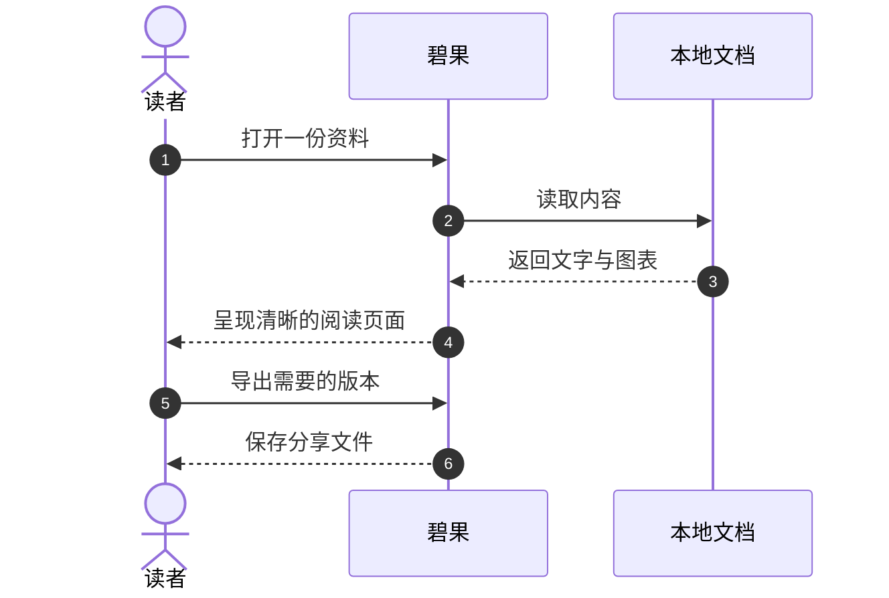

# 欢迎使用碧果

**Pecan · 让每一份文档，读起来更从容。**

一份技术方案、一组工作笔记，或一本值得慢慢读的手册。碧果把文字、代码、图表和公式放在同一张干净的纸页上，让你从打开文档开始，就能把注意力交给内容。

这份指南也是一份可以亲手体验的示例。试试右侧大纲、代码卡片的复制按钮，以及图表的放大预览；随时可以从 **帮助 → 碧果使用指南** 再次打开它。

> [!TIP] 现在就开始
> 按 `⌘O` 打开一份文档，或按 `⌘⇧O` 打开整个文件夹。支持 Markdown、DOCX 和 PDF；如果想先熟悉碧果，沿着这份指南往下读就好。

## 一眼认识碧果

| 你想做的事 | 碧果怎样帮你 |
| --- | --- |
| 浏览一组文档 | 文件目录、多个标签页、拖动排序与文件自动更新 |
| 读清楚长文章 | 右侧大纲、全文搜索、专注模式与可调阅读宽度 |
| 理解技术细节 | 语法高亮、Mermaid 图表、LaTeX 数学与化学式 |
| 看清一张图 | 图片与图表统一放大预览，支持缩放、拖动和适应窗口 |
| 顺手修改内容 | 切换源码编辑，语法高亮、撤销、查找与明确保存 |
| 留下合适的版本 | 导出 PDF、Word、HTML，另存为 Markdown，图表可独立导出 |

## 从打开，到专注

### 把资料放在手边

通过 **文件 → 打开最近文件**，可以回到上次阅读的文档或文件夹。「更多…」（`⌃⌘R`）支持搜索文件名与路径，按方向键选择、Enter 打开；已打开的文档会直接切换到原标签。需要整理历史时，可以清空最近记录。

左侧是文件栏，中间是文档与标签页，右侧是大纲。打开文件夹后，在文件栏选择文档；同时阅读几份资料时，可以拖动标签调整顺序，右键关闭其他标签或复制文件路径。

两侧栏都能拖动边缘调整宽度，也能用顶部按钮收起。工作区不必一成不变：查资料时保留目录，读长文时留下大纲，想安静阅读时按 `⇧⌘F` 进入专注模式。

### 快速找到要读的地方

点击大纲标题，正文会把相应章节带到眼前。按 `⌘F` 查找文字，可以在匹配结果间跳转；正文右键菜单还提供全选、复制 Markdown 全文和导出等操作。

> [!NOTE] 安心阅读本地文件
> 阅读、转换与代码格式化都在本机完成，不改写源文件。进入源码模式后，修改需要明确保存；关闭未保存文档时会提示，外部修改也不会直接覆盖草稿。

### 阅读与修改，随时切换

正文右键选择 **查看源码**，或点击顶部工具栏的 `</>`。正文区域会变成带行号与语法高亮的 Markdown 编辑器，支持撤销、重做、查找和大纲跳转。按 `⌘E` 在源码与阅读之间切换，预览修改后的排版。

按 `⌘S` 保存，`⌘⇧S` 另存为；Windows 使用 `Ctrl`。欢迎页和 Word／PDF 的转换内容会另存为 Markdown，原文档保持不变。想完整体验，可以打开 [源码编辑验收](source-editing.md)。

## 调成舒服的阅读节奏

打开 **设置…**（`⌘,`），选择亮色或暗色主题，分别设置中文与英文字体。正文、代码、界面、Mermaid 与 LaTeX 各有自己的配置，可以兼顾文章的舒展和技术内容的清晰。

| 部位 | 默认值 | 适合怎样调整 |
| --- | --- | --- |
| 正文 | **16px · 1.6 倍行高** | 用舒适的字号和行高，读长段落更轻松 |
| 代码块 | **14px** | 与正文独立设置，保留等宽字体的整齐结构 |
| 阅读宽度 | **960px** | 窄一点便于逐行阅读，宽一点便于比较图表 |
| 界面 / 状态栏 | **14px / 11px** | 保持工具清楚，让正文成为主角 |
| 界面图标 | **16px** | 顶部工具与图表操作使用一致的视觉尺度 |

用 `⌘+` 或 `⌘−` 快速调整正文字号，按 `⌘0` 恢复默认。字体选项来自系统已安装的字体；LaTeX 使用适合数学排版的独立字体选择。

## 文字，也有自己的层次

### 重点、引述与清单

**粗体**适合强调结论，*斜体*适合轻声补充，~~删除线~~保留修改痕迹。行内代码，例如 `request_id`、`GET /api/devices` 和 `设备状态`，用小巧的胶囊把术语与正文区分开。

> 阅读的价值，不只是找到答案，也是在复杂的信息里，看见清楚的关系。

条目让信息更容易扫读，任务清单则让进度一目了然。下面是一份阅读前的小清单：

- [x] 找到要读的资料
- [x] 通过大纲了解文章结构
- [ ] 搜索关键术语，比较相关章节
- [ ] 看清图表，带走需要的内容

### 用表格比较信息

表格支持行内样式，也保留单元格中明确写出的换行。较宽的表格可以横向滚动，不必把每一列都挤成窄窄的文字条。

| 文档元素 | 示例 | 阅读时可以做什么 |
| --- | --- | --- |
| 行内代码 | `device_id` | 清楚辨认标识符，选中后复制 |
| 强调与链接 | **重要结论** · [Markdown 语法](https://commonmark.org/help/) | 扫读重点，点击链接查看参考资料 |
| 多行内容 | 第一行<br>第二行 | 保留作者主动安排的换行 |

## 代码：看得清，也带得走

代码卡片显示语言名称，支持语法高亮。默认按每个代码块识别缩进，也可在 **设置 → 阅读 → 缩进与 Tab 宽度** 中选择 2、4 或 8 列。代码不自动换行，长行支持水平滚动。

代码在文档加载时按配置的 Tab 宽度自动排版。支持 JSON / YAML / TOML、JavaScript / TypeScript、CSS、HTML / XML 和 SQL 等语言；切换工具栏的 Tab 宽度后，本块会自动重新格式化。右上角还可折叠整块和复制完整代码，左侧箭头可按语法结构折叠。源 Markdown 保持原样，搜索仍定位到对应文字；未支持的语言保留原排版。更多样例见 [多语言格式化验收](auto-formatting.md)。

```rust
use std::path::Path;

/// 让一份资料成为一次专注阅读的起点。
fn document_title(path: &Path) -> Option<&str> {
    path.file_stem()?.to_str()
}

fn main() {
    let title = document_title(Path::new("阅读笔记.md"));
    println!("准备阅读：{}", title.unwrap_or("未命名文档"));
}
```

不同语言使用各自的高亮。配置、日志和接口示例也可以有清楚的结构：

```json
{
  "document": "阅读笔记.md",
  "reading": {
    "font_size": 16,
    "content_width": 960,
    "focus": true
  }
}
```

## 图表：把关系画出来

### 看见一条清楚的路径

Mermaid 可以把文档中的流程和关系变成图表。下面这张流程图，描述了一份资料从打开到分享的过程：


### 读懂一次交互

时序图适合表达谁先做了什么。你可以在正文中查看 Mermaid 源码，也可以直接复制源码，继续用于自己的文档。



::: 放大，看看细节
点击图片或 Mermaid 图表，就会打开统一的放大预览。默认适应窗口；底部可调整缩放，放大后可以拖动查看，按 `Escape` 返回正文。查看源码和复制等操作留在正文卡片上，让预览专心呈现图片本身。
:::

图表右上角的 `</>` 按钮切换源码视图，源码同样支持高亮。下载按钮可以单独导出 **SVG** 或 **高清 PNG**；SVG 适合继续编辑和放大使用，PNG 适合插入演示稿或发送给同事。

## 公式与化学式：让表达保持完整

短公式可以融入一句话，比如 $E=mc^2$。需要展开推导时，独立公式会留出更从容的空间。LaTeX 字体与字号可单独设置，独立公式下方还可以复制源码。

### 从一个熟悉的公式开始

当 $a\ne 0$ 时，一元二次方程 $ax^2+bx+c=0$ 的解为：

$$
x = \frac{-b \pm \sqrt{b^2 - 4ac}}{2a}
$$

求和、分式与矩阵也能保持各自的排版层次：

$$
\bar{x}=\frac{1}{n}\sum_{i=1}^{n}x_i
\qquad
\mathbf{A}=\begin{pmatrix}a&b\\c&d\end{pmatrix}
$$

### 反应式与离子

化学式支持常见的元素下标、离子电荷与反应箭头。例如水的生成，以及碳酸钙的分解：

$$
\ce{2H2 + O2 -> 2H2O}
$$

$$
\ce{CaCO3 -> CaO + CO2}
$$

## Word 与 PDF，沿用同一套阅读方式

直接打开 DOCX 或 PDF，就能继续使用搜索、大纲与阅读设置。Word 的内嵌图片和支持的公式会保留；PDF 默认重排文本，便于按自己的字号和宽度阅读。

> [!IMPORTANT] 需要原始版面时
> 扫描 PDF、多栏排版或复杂表格，建议使用 **文件 → 查看 PDF 原版**，或点击标签栏的 **原版查看**。它保留原始页面、图片与布局，适合核对版式。

重排阅读适合连续阅读文字，原版查看适合对照页面。这两种方式可以随内容需要切换。

## 读完之后，留下合适的版本

在系统 **文件** 菜单选择导出格式，或在正文右键菜单打开 **导出文档**（PDF、Word、HTML）。Markdown 通过 **文件 → 另存为…** 保存。导出前先选适合用途的格式：

| 格式 | 适合用来 | 保存后的特点 |
| --- | --- | --- |
| **PDF** | 发给他人、归档与打印 | 分页阅读，保留矢量图表与公式 |
| **Word** | 交给同事继续编辑 | 可编辑的文字、表格与图片 |
| **HTML** | 在浏览器阅读或独立分享 | 单份页面，便于打开查看 |
| **Markdown** | 保留源码，继续写作 | 保留 Markdown 内容与所需图片资源 |

> [!NOTE] 带上文档的图片
> 另存为 Markdown 后，如果同时生成了图片资源目录，分享时请把文档和资源目录一起带走，保持它们的相对位置。

## 常用操作，记住这几组就够了

以下是当前 macOS 版本的快捷键。完整操作也可以在顶部系统菜单中找到。

| 操作 | 快捷键 |
| --- | --- |
| 打开文件 / 文件夹 | `⌘O` / `⌘⇧O` |
| 查找正文 / 源码 | `⌘F` |
| 切换源码 / 保存 / 另存为 | `⌘E` / `⌘S` / `⌘⇧S` |
| 展开或收起文件栏 / 大纲 | `⌘B` / `⌘L` |
| 打开设置 | `⌘,` |
| 增大 / 减小 / 恢复正文字号 | `⌘+` / `⌘−` / `⌘0` |
| 专注阅读 | `⇧⌘F` |
| 关闭放大预览 | `Escape` |

---

**准备好了吗？** 打开你想读的那份文档，让碧果陪你把它读清楚。
